# 대치 수프리마 대입전략연구소 관리자 홈(Admin Hub) 전 메뉴 사용 매뉴얼 및 마스터 운영 가이드

**문서 번호**: SUPRIMA-MANUAL-ADMIN-2026-V1  
**발행 기관**: 대치 수프리마 대입전략연구소 (Daechi Suprima Admissions Strategy Lab)  
**작성 책임**: 이기욱 대표컨설턴트  
**적용 대상**: 총괄 마스터(Master), 학원 관리자(Admin), 수석 컨설턴트  
**발행 일자**: 2026년 11월 16일  
**문서 등급**: 최고 관리자 실무 매뉴얼 (Confidential & Operational)  

---

## 1. 관리자 홈(Admin Hub) 개요 및 마스터 권한 안내

### 1.1 관리자 홈의 목적과 위상
대치 수프리마 「관리자 홈(`app/admin`)」은 전국 164개 대학 입결 데이터베이스, 제휴 학원 B2B 계정 발급, 학생 개인별 세특/탐구 활동 이력, 서비스 결제 정책을 중앙에서 총괄 통제하는 **최고 관리자(Master) 전용 관제 센터**입니다.

### 1.2 마스터(Master) 권한의 특별한 범위
마스터 계정으로 접속 시, 단일 학원의 관리자에 국한되지 않고 시스템 전체에 걸쳐 다음과 같은 **전방위 무제한 액션 권한**이 오픈됩니다:
1. **학원용 관리 앱(컨설턴트 앱) 전 기능 프리패스**:
   * **학원 관리자(원장) 권한**: 전체 강사 계정 조회, 학생별 담당자 배정 및 회수, 학원 환경 설정
   * **담당 컨설턴트 권한**: 전체 학생 성적 정밀 분석, 밀착 플래너 작성, 3단계 나이스 세특 검수, 1-Click 추천서 발행, 월간 활동 보고서 A4 출력 및 학부모 메일링
2. **전국 164개 대학 26,295개 컷오프 DB 직접 관리**: 엑셀 업로드, 오류 검증, 실서비스 즉시 반영 및 롤백.
3. **제휴 학원 계정 신규 발급 및 비밀번호 즉각 초기화**: 학원의 요청 시 즉각적인 계정 발급 및 장애 처리.

### 1.3 마우스 호버 퀵 가이드 인터랙션 (Hover Preview Navigator)
관리자 홈 상단에는 **마우스를 올려놓기만 해도 즉시 해당 메뉴의 핵심 용도와 실무 워크플로우가 펼쳐지는 인터랙티브 퀵 가이드**가 탑재되어 있습니다.
* **작동 방식**: 상단 네비게이터 메뉴 버튼 또는 각 섹션 카드 위에 마우스 커서를 올리면(Mouse Enter), 하단 플로팅 패널에 3초 요약, 대상 사용자, 사용 시점, 3단계 표준 워크플로우, 마스터 실무 팁이 즉시 전환되어 표시됩니다.
* **상세 매뉴얼 펼치기**: 각 카드 하단의 `[▼ 상세 사용 매뉴얼 펼치기]`를 클릭하면 전체 프로세스를 아코디언 형태로 자세히 확인할 수 있습니다.

---

## 2. 6대 관리자 메뉴별 상세 사용 매뉴얼

---

### [메뉴 01] 학원용 관리 앱 (컨설턴트 앱 Pro)
* **접속 경로**: `consultantapp.vercel.app` (또는 관리자 홈 내 1-Click 바로가기)
* **담당 대상**: 총괄 마스터(전 권한 오픈), 학원 원장(관리자), 담당 컨설턴트
* **한 줄 핵심 용도**: 컨설턴트의 4대 실행 항목(진단 ➔ 플래너 ➔ 도서/세특 ➔ 월간 보고서)을 밀착 코칭하고, 실행 데이터를 자동 집계해 A4 출력 및 학부모 원클릭 메일링을 전송하는 **현장 코칭 전용 워크스페이스**.

#### 💡 이럴 때 사용하세요!
* 신규 수강생 등록 및 학생별 담당 컨설턴트 1-Click 배정 시.
* 5등급제 ⟷ 9등급제 내신 성적 자동 환산 및 164개 대학 학종/교과 전형 적합도를 파악할 때.
* 주차별 밀착 플래너에서 학습 과제를 부여하고 달성률을 체크할 때.
* 수프리마랩 도서 DB와 연동하여 학생의 희망 진로에 맞춘 필독서와 3단계 완성형 세특 문장을 검수·배정할 때.
* 월말 정기 평가 시 **[⚡ 실행 데이터 자동 집계]**를 눌러 월간 활동 보고서를 1초 만에 완성하고, 학부모 상담용 A4 출력 및 이메일(메일링)을 발송할 때.

#### 🛠️ 단계별 표준 작업 순서
1. **[1단계: 진단] 학생 CRM & 학생부 분석 (`analysis`)**:
   * 학생 카드를 클릭하여 5/9등급 자동 환산 성적 및 수시 컷오프 대비 모의 지원 적합도를 확인합니다.
2. **[2단계: 실행] 주차별 밀착 플래너 (`planner`)**:
   * 1~4주차별 주간 학습 및 탐구 과제를 부여하고, 수행 여부 및 컨설턴트 피드백 노트를 기록합니다.
3. **[3단계: 심화] 탐구·독서·세특 추천 & AI 매칭 (`recommendation`)**:
   * 수프리마랩 도서 DB 기반 필독서를 배정하고, 나이스 3단계(동기-과정-변화) 세특 문장을 검수한 후 A4 추천서를 발행합니다.
4. **[4단계: 보고서] 월간 활동 보고서 발행 & A4 출력 / 메일링 (`evaluation`)**:
   * `[⚡ 실행 항목 데이터 자동 집계 및 반영 (Auto-Fill)]` 버튼을 클릭하여 플래너 달성률과 도서·세특 내역을 자동 요약합니다.
   * `[즉시 인쇄 (A4)]` 버튼으로 학부모 대면 상담용 보고서를 출력하거나, `[✉️ 학부모/학생 메일 발송]` 버튼으로 정식 HTML 리포트를 원클릭 전송합니다.

#### 💡 마스터 실무 팁
마스터 로그인 시 모든 학원 및 컨설턴트 권한이 완전 개방되어 전 학생을 열람/관리할 수 있으며, 컨설턴트가 수행한 일상 업무가 월간 보고서로 자동 변환되어 업무 부담을 90% 이상 절감합니다.

---

### [메뉴 02] 학원 권한 · 계정 발급 & 학생 배정 점검 (`/admin/academy`)
* **접속 경로**: `/admin/academy`
* **담당 대상**: 총괄 마스터 전용
* **한 줄 핵심 용도**: 전국 제휴 학원의 원장 및 강사에게 **로그인 계정을 발급하고, 비밀번호를 초기화하며, 학생 배정 상태를 감사(Audit)**하는 관제소.

#### 💡 이럴 때 사용하세요!
* 신규 학원과 B2B 도입 계약이 체결되어, 해당 학원의 원장님 계정(admin)과 소속 강사 계정(consultant)을 신규 발급해 주어야 할 때.
* 학원 원장님이나 강사가 비밀번호를 분실하여 본사에 재설정(초기화)을 요청했을 때.
* 특정 학원의 학생이 퇴원하거나 담당 강사가 퇴사하여 배정 상태를 점검하고 정리해야 할 때.

#### 🛠️ 단계별 표준 작업 순서
1. 상단 `학원 선택` 드롭다운에서 계정을 발급할 제휴 학원을 선택합니다.
2. **계정 신규 발급**:
   * `이름`, `이메일(로그인 ID)`, `역할(학원 관리자 vs 실행 담당자)`, `초기 비밀번호` 입력.
   * `[계정 발급]` 버튼을 클릭하면 계정이 즉시 생성되며 해당 학원 소속으로 바인딩됩니다.
3. **비밀번호 재설정 (초기화)**:
   * 담당자 목록 테이블에서 해당 강사의 `[비밀번호 재설정]` 클릭 ➔ 새 비밀번호 입력 ➔ 저장.
4. **학생 배정 감사 리포트 (하단)**:
   * 미배정 학생 수, 중복 배정 여부, 삭제된 계정에 배정된 고아 학생 유무를 확인하고 정리합니다.

#### 💡 마스터 실무 팁
학원 담당자가 로그인하지 못할 때 이 메뉴에서 이메일과 비밀번호를 즉시 재설정해 줄 수 있습니다.

---

### [메뉴 03] 입시 데이터 관리 (`/admin/admissions`)
* **접속 경로**: `/admin/admissions`
* **담당 대상**: 총괄 마스터 전용
* **한 줄 핵심 용도**: 전국 164개 대학 26,295개 수시 전형 **합격 컷오프(입결) 원본 데이터베이스 엑셀 업로드, 정밀 검증, 배포 및 롤백**.

#### 💡 이럴 때 사용하세요!
* 대학별 전년도 수시 입시 결과(70% 컷, 50% 컷)가 대교협 어디가에 최종 공시되어 시스템에 반영해야 할 때.
* 2028 개편에 맞춰 대학별 신설 학과 및 변경된 전형 방식을 대량 업데이트할 때.
* 데이터 입력 오류가 발생하여 즉시 이전 정상 버전으로 원상복구(롤백)해야 할 때.

#### 🛠️ 단계별 표준 작업 순서
1. **엑셀 템플릿 준비**: 표준 양식(대학명, 캠퍼스, 학과명, 전형유형, 세부전형명, 50%컷, 70%컷) 작성.
2. **파일 업로드 및 자동 검증 (Staging)**:
   * CSV 또는 XLSX 파일을 드래그 앤 드롭 ➔ 시스템이 164개 대학 코드 및 5등급/9등급 값의 유효성을 1초 만에 자동 검증.
   * 오류 행이 있을 경우 오류 라인과 원인을 화면에 즉시 표시.
3. **실서비스 배포 (`Publish`)**:
   * 검증 완료 후 `[실서비스 반영(Publish)]` 클릭 ➔ 1초 만에 진단 엔진 및 학생/학원 화면에 실시간 적용.
4. **비상 복구 (`Rollback`)**:
   * 문제 발생 시 `[이전 버전 복원]` 클릭 ➔ 직전 불변 리비전으로 즉각 롤백.

#### 💡 마스터 실무 팁
데이터 검증이 통과되지 않으면 실서비스 배포가 차단되므로 잘못된 입결 수치가 학생들에게 노출될 위험이 원천 차단됩니다.

---

### [메뉴 04] 학생 개인 활동 · 계정 연결 (`/admin/activities`)
* **접속 경로**: `/admin/activities`
* **담당 대상**: 총괄 마스터, 수석 컨설턴트
* **한 줄 핵심 용도**: 학생이 「나의 입시멘토」 모바일/웹에서 수행한 **탐구 과제·도서·세특 작성 이력 조회 및 학원-학생 1:1 연동 코드 관리**.

#### 💡 이럴 때 사용하세요!
* 학생이 학원과 연동하기 위해 발급받은 6자리 연결 코드가 분실되었거나 만료되어 확인/재발급이 필요할 때.
* 학생이 작성한 탐구 보고서의 버전별 수정 내역(1차 제출본 ➔ 2차 첨삭본 ➔ 최종본)을 비교 검토할 때.
* 학생 데이터의 무결성과 활동 로그를 감사할 때.

#### 🛠️ 단계별 표준 작업 순서
1. 학생명 또는 학생 고유 식별자로 학생을 검색합니다.
2. 학생 상세 프로필에서 `연결 코드 발급 현황` 및 유효기간을 확인합니다.
3. 학생의 자율활동, 동아리활동, 진로활동, 과목별 세특 활동 타임라인을 확인하고 버전별 변경 사항을 조회합니다.

#### 💡 마스터 실무 팁
학생 발급 연동 코드는 1회 인증 완료 시 즉시 만료되어 타 학원 또는 타인에게 오연동되는 보안 사고를 방지합니다.

---

### [메뉴 05] 가격 · 결제 관리 (`/admin/pricing`)
* **접속 경로**: `/admin/pricing`
* **담당 대상**: 총괄 마스터 전용
* **한 줄 핵심 용도**: 개인(B2C) 및 학원(B2B) 서비스의 **이용권 요금제 설정, 프로모션 가격 관리, 카드/계좌 결제 내역 확인**.

#### 💡 이럴 때 사용하세요!
* 학기제 관리 모델(1개 학기 종료 시점 기준 잔여 개월 산정) 요금제를 설정 및 조정할 때.
* 학생/학부모의 유료 결제 승인 내역, 결제 일자, 영수증 번호를 대조할 때.
* 환불 요청이 접수되어 결제 상태를 확인하고 승인 취소할 때.

#### 🛠️ 단계별 표준 작업 순서
1. `요금제 설정` 탭에서 각 서비스 과정별 정가 및 할인 프로모션 금액을 입력하고 저장합니다.
2. `결제 내역` 탭에서 최근 결제된 주문 목록을 일자별, 결제 수단별로 필터링하여 조회합니다.
3. 미결제 및 결제 실패 오류 건에 대해 사유를 확인하고 고객 안내를 진행합니다.

#### 💡 마스터 실무 팁
대치 수프리마는 엄격한 **100% 유료 프리미엄 모델**로 운영되며, 무료 플랜은 일절 제공하지 않습니다.

---

### [메뉴 06] 학생부 PDF 안전 보관소 점검 (`PdfStorageSetup`)
* **접속 경로**: 관리자 홈 인라인 설정 블록
* **담당 대상**: 총괄 마스터 전용
* **한 줄 핵심 용도**: 학생이 등록하는 정부24 나이스 생활기록부 PDF의 **비공개 암호화 저장소 및 OCR AI 파서 통신 상태 점검**.

#### 💡 이럴 때 사용하세요!
* 시스템 정기 점검 시, 대용량 PDF 업로드와 텍스트 추출 엔진의 연결 상태를 확인할 때.
* 학생들의 개인정보가 저장소 내에서 암호화되어 안전하게 보호되고 있는지 감사할 때.
* 새로운 저장소 버킷 생성 또는 API 접근 토큰 갱신 시.

#### 🛠️ 단계별 표준 작업 순서
1. **스토리지 연결 상태 확인**: 관리자 홈 내 `학생부 PDF 보관` 카드에서 `[설정 및 상태 점검]` 클릭.
2. **보안 암호화 규칙 점검**: 비공개 버킷 읽기/쓰기 권한 및 서버 사이드 암호화(AES-256) 적용 여부 확인.
3. **OCR AI 파서 테스트**: 샘플 PDF 파싱을 실행하여 교과목명, 성적, 세특 텍스트 추출 정상 여부 검증.

#### 💡 마스터 실무 팁
학생부 원본 PDF는 민감 개인정보이므로, 본 인프라 점검 도구를 통해 인가되지 않은 외부 접근을 원천 차단합니다.

---

## 3. 컨설턴트 관리 영역 체계화 및 월간 활동 보고서(A4출력/메일링) 연계 가이드

### 3.1 컨설턴트 관리 영역과 월간 보고서의 유기적 관계 (설계 철학)
컨설턴트의 관리 영역은 독립적으로 존재하는 서류 작업이 아니라, **"매월 학생을 지도하고 코칭한 실행 항목들이 그대로 월간 활동 보고서의 내용으로 전환되는 구조"**로 설계되었습니다.

```mermaid
flowchart LR
    subgraph Execution ["컨설턴트 일상 관리 영역 (실행 항목)"]
        direction TB
        E1["1. 학생부·성적 분석<br/>(내신 5/9등급 환산 & 164개 대학 진단)"]
        E2["2. 주차별 밀착 플래너<br/>(1~4주차 과제 부여 & 달성률 체크)"]
        E3["3. 탐구·독서·세특 추천<br/>(수프리마랩 도서 DB & 3단계 세특 문장 검수)"]
    end

    subgraph Auto ["1-Click 자동 집계 (Auto-Fill)"]
        AF["⚡ 실행 항목 데이터 자동 집계 엔진"]
    end

    subgraph Report ["월간 학습·탐구 활동 보고서 (성과 산출물)"]
        direction TB
        R1["1. 학습 태도 및 참여도 분석<br/>(플래너 과제 달성률 % 및 성실성)"]
        R2["2. 주제 탐구 및 역량 평가<br/>(배정 도서명, 탐구 가설, 3단계 세특)"]
        R3["3. 차월 입시 코칭 중점 계획<br/>(취약 과목 클리닉 & 학기 로드맵)"]
    end

    subgraph Output ["출력 및 발송 채널"]
        P1["🖨️ A4 용지 즉시 인쇄<br/>(대치수프리마 직인 날인 대면 상담용)"]
        M1["✉️ 학부모/학생 메일링 발송<br/>(공식 브랜딩 HTML 리포트 원클릭 전송)"]
    end

    Execution --> AF
    AF --> Report
    Report --> Output
```

### 3.2 컨설턴트 4대 실행 항목 상세 명세 (Action Items)

| 단계 | 실행 항목 (컨설턴트 업무) | 핵심 실행 내용 및 도구 | 월간 활동 보고서 자동 연계 항목 |
| :---: | :--- | :--- | :--- |
| **01** | **학생부·성적 정밀 진단** | • 5등급제 ⟷ 9등급제 자동 환산 • 164개 대학 26,295개 수시 컷오프 비교 • 목표 대학 라인 및 취약 과목 도출 | • 보고서 상단 학생 프로필 • 목표 대학 및 내신 추이 요약 |
| **02** | **주차별 밀착 플래너 관리** | • 1~4주차별 탐구 과제 부여 • 학생 과제 완료 체크리스트 • 컨설턴트 관찰 코멘트 기록 | • **1. 학습 태도 및 수업 참여도 분석** (과제 달성률 %, 이행 성실도 자동 반영) |
| **03** | **수프리마랩 도서 & 3단계 세특 검수** | • 학생 희망 진로 맞춤 수프리마랩 도서 DB 배정 • 4단계 정교화 프로세스 가이드 탐구 가설 수립 • 3단계(동기-과정-변화) 나이스 문장 완성 및 추천서 발행 | • **2. 주제 탐구 및 과제 수행 역량 평가** (추천 도서명, 탐구 주제, 세특 완성도 자동 반영) |
| **04** | **월간 활동 보고서 발행 & 발송** | • `[⚡ 실행 데이터 자동 집계(Auto-Fill)]` 클릭 • 차월 코칭 중점 계획 및 총평 다듬기 • **A4 즉시 인쇄** 또는 **이메일(메일링) 원클릭 발송** | • **3. 향후 학습 및 입시 코칭 중점 계획** • A4 출력본 & 학부모 메일링 본문 생성 |

### 3.3 A4 인쇄 및 학부모 원클릭 메일링(이메일 발송) 실무
1. **A4 즉시 인쇄 (대면 상담용)**:
   * 평가서 목록에서 보고서를 선택하고 `[인쇄 미리보기]` ➔ `[즉시 인쇄 (A4)]` 클릭.
   * 대치수프리마 공식 직인("대치수프리마 입시&코칭센터 [인]")과 공식 사업자 푸터가 포함된 고품격 상담 자료 출력.
2. **학부모/학생 원클릭 메일링 (원격 발송용)**:
   * 평가서 목록 또는 인쇄 미리보기 화면에서 `[✉️ 학부모/학생 메일 발송]` 버튼 클릭.
   * 수신자 이메일(학부모) 확인 및 맞춤 인사말 입력 ➔ `[✉️ 보고서 메일 즉시 전송]` 클릭.
   * 본사 발송 서버(Resend)를 통해 대치수프리마 정규 버건디 테마 HTML 이메일이 실시간 발송 완료.

### 3.4 총괄 마스터(Master) & 학원 관리자(원장)의 컨설턴트 관제
* **학생 배정 감사**: 미배정 학생 0명 유지, 퇴사 강사 학생 즉각 재배정.
* **월간 보고서 발송률 모니터링**: 제휴 학원 전체 수강생 대비 당월 활동 보고서 작성 및 메일링 완료율 실시간 추적.
* **3단계 세특 완성도 감사**: 학교 제출 마감 전 수프리마랩 도서 DB 연계 세특 문장의 나이스 규격 준수 여부 일괄 점검.

---

## 4. 학기 관리 기간 산정 공식 및 요금 체계

대치 수프리마의 정규 관리 기간은 **1개 학기 단위**로 운영되며, 가입 시점부터 해당 학기 종료 시점까지의 잔여 개월 수를 기준으로 관리 기간 및 비용이 책정됩니다:

$$\text{관리 개월 수} = \text{해당 학기 종료 시점} - \text{가입 시점}$$

### 4.1 학기별 종료 기준 시점
* **1학기 종료 시점**: **8월 말** (3월 ~ 8월)
* **2학기 종료 시점**: **익년 2월 말** (9월 ~ 다음 해 2월)

### 4.2 가입 월별 관리 기간 계산 예시표
| 가입 시점 | 목표 종료 시점 | 산정 개월 수 | 프로그램 성격 |
| :---: | :---: | :---: | :--- |
| **12월 가입** | 익년 2월 말 종료 | **3개월** | 겨울방학 학년 전환기 학생부 완성 및 1학기 선행 집중 코칭 |
| **5월 가입** | 당해 8월 말 종료 | **3개월** | 1학기 기말고사 대비 및 여름방학 세특 심화 보고서 완성 |
| **3월 가입** | 당해 8월 말 종료 | **6개월** | 1학기 풀코스 정규 케어 (중간·기말고사 + 나이스 세특 최종 입력) |
| **9월 가입** | 익년 2월 말 종료 | **6개월** | 2학기 풀코스 정규 케어 (2학기 내신 관리 + 학년말 최종 세특) |

---

## 5. 마스터 운영 1일 / 주간 / 월간 체크리스트

| 주기 | 점검 항목 | 실행 메뉴 | 완료 기준 |
| :---: | :--- | :--- | :--- |
| **일간 (Daily)** | • 신규 가입 학생 및 결제 승인 내역 확인 • 신규 제휴 학원 계정 발급 요청 처리 • 비밀번호 분실 재설정 요청 즉각 대응 | 가격·결제 관리 (`/admin/pricing`) 학원 계정 관리 (`/admin/academy`) | 당일 요청 건 100% 처리 완료 |
| **주간 (Weekly)** | • 제휴 학원별 학생 배정 누락 여부 점검 • 컨설턴트 앱 학생 상담 진도 모니터링 • 주차별 플래너 과제 달성률 점검 | 학원 계정 관리 (`/admin/academy`) 컨설턴트 앱 (`Dashboard`) | 미배정 학생 0명 유지 |
| **월간 (Monthly)** | • 대학별 최신 컷오프 업데이트 반영 • 학기 종료 시점(~8월/~2월) 잔여 개월수 산정 점검 • **전체 수강생 월간 활동 보고서 작성 및 학부모 메일링 발송률 100% 점검** | 입시 데이터 관리 (`/admin/admissions`) 가격 및 학기 관리 월간 보고서 관제 | 164개 대학 입결 무결성 100% 검증 & 보고서 전원 발송 |

---

## 6. 자주 묻는 질문 (FAQ) 및 비상 조치 가이드

### Q1. 학원 원장님이나 강사가 로그인이 안 된다고 문의합니다.
* **해결법**: `학원 권한·계정 발급`(`/admin/academy`) 메뉴로 들어가 해당 학원을 선택합니다. 등록된 이메일 철자를 대조하고, 목록 우측의 `[비밀번호 재설정]`을 클릭하여 새 암호를 발급한 뒤 학원에 안내합니다.

### Q2. 엑셀 업로드 시 특정 대학 행에서 오류가 발생합니다.
* **해결법**: `입시 데이터 관리`(`/admin/admissions`) 메뉴에서 오류 로그를 확인합니다. 대학명 또는 캠퍼스명이 164개 표준 코드와 일치하는지, 컷오프 등급이 유효한 숫자인지 확인 후 엑셀을 수정하여 재업로드합니다.

### Q3. 학생이 학원 코드를 입력했는데 연결되지 않는다고 합니다.
* **해결법**: `학생 개인 활동`(`/admin/activities`) 메뉴에서 해당 학생을 검색합니다. 발급된 6자리 연동 코드가 유효시간 내인지 확인하고, 만료된 경우 `[재발급]`을 눌러 새 코드를 부여합니다.

### Q4. 월간 활동 보고서를 학부모님께 이메일로 전송할 때 발송 실패 오류가 납니다.
* **해결법**: 입력된 학부모 이메일 주소의 오탈자(`@`, `.com` 등)를 확인합니다. 본사 서버의 `RESEND_API_KEY` 환경변수가 정상 활성화되어 있는지 점검하며, 필요한 경우 즉시 `[A4 즉시 인쇄]`를 눌러 서면 출력물로 먼저 제공합니다.

---

**대치수프리마 대입전략연구소**  
대표: 이기욱 | 사업자등록번호: 369-81-03608 | 통신판매업신고번호: 2026-서울강남-01984호  
주소: 서울특별시 강남구 대치동 906-22 동관빌딩 4층 대치수프리마 대입전략연구소  
연락처: 02-555-1234 | 이메일: contact@suprima.kr  
Copyright © 2026 대치수프리마 대입전략연구소. All rights reserved.
