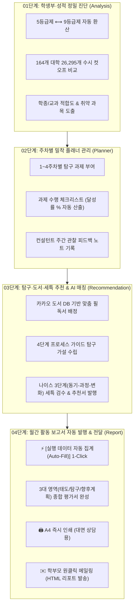
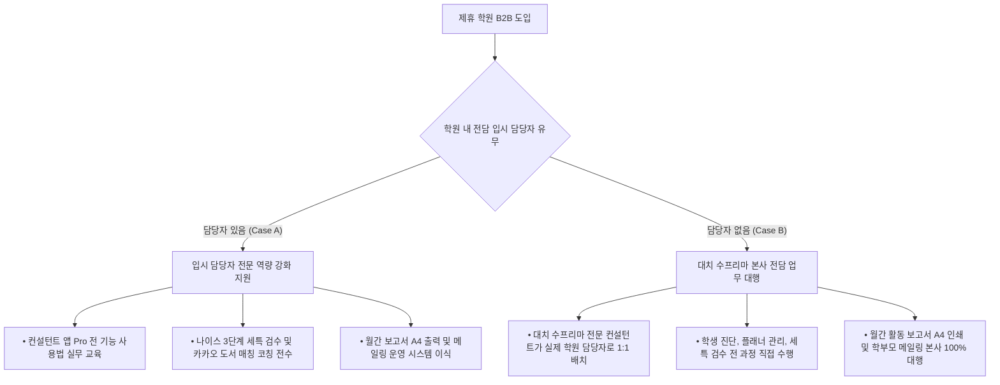

# 대치 수프리마 대입전략연구소 컨설턴트 업무 매뉴얼 및 실무 가이드

**문서 번호**: SUPRIMA-MANUAL-CONSULTANT-2026-V1  
**발행 기관**: 대치 수프리마 대입전략연구소 (Daechi Suprima Admissions Strategy Lab)  
**작성 책임**: 이기욱 대표컨설턴트  
**적용 대상**: 제휴 학원 담당 컨설턴트, 학원 원장(관리자), 입시 총괄 마스터  
**발행 일자**: 2026년 11월 16일  
**문서 등급**: 컨설턴트 표준 실무 지침서 (Standard Operational Procedure)  

---

## 1. 컨설턴트 업무 철학 및 핵심 관리 체계

### 1.1 컨설턴트의 미션과 역할
대치 수프리마 컨설턴트는 단순한 성적 상담가를 넘어, **학생의 잠재 역량을 발굴하고 교육부 나이스(NEIS) 기재 기준에 부합하는 정밀한 학생부를 완성하는 최고 입시 디렉터**입니다.
컨설턴트가 수행하는 일상 코칭은 학생에게 실질적인 합격 로드맵을 제시하며, 학부모에게는 투명한 신뢰를 제공합니다.

### 1.2 핵심 관리 체계: "실행 항목이 곧 보고서가 되는 1:1 직결 시스템"
컨설턴트의 업무는 별도의 번거로운 행정 서류 작성이 아닙니다.
**"평소 학생과 진행한 3대 실행(진단 ➔ 플래너 ➔ 세특/도서) 데이터가 [월간 활동 보고서]로 자동 집계(Auto-Fill)되어, A4 출력 및 학부모 원클릭 메일링으로 직결"**되는 최첨단 워크플로우를 제공합니다.

---

## 2. 컨설턴트 4대 실행 사이클 상세 실무 매뉴얼

---

### [01단계] 학생부 · 성적 정밀 진단 (`analysis`)
* **담당 화면**: `StudentDetail` ➔ `1. 학생부·성적 분석`
* **주요 목적**: 학생의 실제 성적 데이터를 기반으로 2028 개편 5등급제와 현행 9등급제를 교차 분석하고, 전국 164개 대학 합격 컷오프 대비 모의 지원 위치를 진단합니다.

#### 🛠️ 표준 실무 순서
1. **성적 및 학생부 데이터 입력**:
   * 나이스 생활기록부 PDF 업로드(2MB 이하) 또는 교과목별 등급/원점수 직접 입력.
   * `희망 진로/목표 전공`(예: 의예과, 컴퓨터공학과, 경영학과) 및 현재 평균 등급(GPA) 확인.
2. **5등급 ⟷ 9등급 자동 환산 검토**:
   * 성적 추이 그래프를 통해 학기별 성적 상승/하락 곡선과 취약 교과목을 도출합니다.
3. **164개 대학 26,295개 수시 전형 컷오프 매칭**:
   * 상향/적정/안정 지원 가능 대학 라인을 진단하고, 학생부 종합전형(학종)과 학생부 교과전형 중 유리한 전형 전략을 확정합니다.

#### 💡 실무 팁
진단 결과 요약문(`result.summary`)은 추후 **월간 활동 보고서 상단 프로필 및 목표 대학 코멘트**에 자동으로 연동됩니다.

---

### [02단계] 주차별 밀착 플래너 관리 (`planner`)
* **담당 화면**: `StudentDetail` ➔ `2. 밀착 플래너`
* **주요 목적**: 월간 목표를 달성하기 위해 1주차부터 4주차까지 주차별 구체적 탐구 과제를 부여하고, 수행 달성률을 추적 관리합니다.

#### 🛠️ 표준 실무 순서
1. **주차별 탐구 과제 부여**:
   * 과제 입력창에 주차(1주차~4주차)를 선택하고 과제 내용을 입력한 뒤 `[추가]` 클릭.
   * *과제 예시*: `1주차: 카카오 도서 DB 추천 도서 1~3장 정독 및 핵심 가설 메모 작성`  
   * *과제 예시*: `2주차: 교과 개념 연계 심화 탐구 보고서 1차 초안 제출`  
   * *과제 예시*: `3주차: 컨설턴트 3단계 세특 첨삭본 반영 및 수정 보고서 완성`  
   * *과제 예시*: `4주차: 학교 담당 교사 질의응답 및 나이스 제출용 세특 텍스트 확정`
2. **학생 수행 여부 점검 (Checklist)**:
   * 학생이 과제를 제출하면 해당 과제의 체크박스를 체크하여 완료(`completed: true`) 처리합니다.
   * 전체 과제 수 대비 완료 건수를 통해 **과제 달성률(%)이 실시간 자동 계산**됩니다.
3. **컨설턴트 피드백 노트 기록**:
   * 주차별 학생의 학습 태도, 과제 성실도, 질문의 깊이 등을 피드백 입력창에 기록합니다.

#### 💡 실무 팁
플래너에서 체크된 **과제 달성률(%)과 컨설턴트 관찰 코멘트**는 월간 보고서 작성 시 **[1. 학습 태도 및 수업 참여도 분석]** 영역에 1초 만에 자동 집계됩니다.

---

### [03단계] 카카오 도서 DB 연계 탐구 & 3단계 세특 검수 (`recommendation`)
* **담당 화면**: `StudentDetail` ➔ `3. 탐구·독서·세특 추천 & AI 매칭`
* **주요 목적**: 학생의 희망 진로에 맞춘 최적의 필독서를 **카카오 도서 DB**에서 연계 배정하고, 교육부 나이스 기재 기준 3단계(동기-탐구과정-성장변화) 완성형 세특 문장을 검수하여 추천서를 발행합니다.

#### 🛠️ 표준 실무 순서
1. **수프리마 엄선 템플릿 선택 및 카카오 도서 매칭**:
   * `[+ 신규 추천 및 AI 매칭]` 클릭 ➔ 4개 카테고리(과학AI, 사회AI, AI데이터분석, 교과탐구) 중 학생 전공에 맞는 템플릿 선택.
   * 카카오 도서 DB와 연동된 추천 도서명, 저자, 출판사, 핵심 이론 요약을 확인합니다.
2. **수프리마 4단계 정교화 프로세스 가이드 적용**:
   * **STEP 1 (배경지식 확립)**: 카카오 도서를 통한 기초 이론 및 개념 정립.
   * **STEP 2 (가설 및 질문 수립)**: 도서 내용과 교과 진도를 융합한 핵심 탐구 가설 도출.
   * **STEP 3 (실험·조사·데이터 분석)**: 공공 데이터나 교과 실험을 통한 가설 검증.
   * **STEP 4 (결론 도출 및 학업적 성장)**: 탐구를 통해 확장된 학업 역량 정리.
3. **나이스 3단계 완성형 세특 문장 검수**:
   * 나이스 기재 금지 사항(공인어학성적, 외부 경시대회, 도서명 단순 나열 등)을 배제하고, **[동기 ➔ 탐구과정 ➔ 성장변화]** 구조로 문장을 완성합니다.
4. **추천서 A4 규격 출력 (`printRec`)**:
   * `[인쇄 미리보기]` 클릭 ➔ 대치수프리마 직인이 날인된 A4 맞춤 추천서를 원클릭 인쇄하여 학생/학부모에게 전달합니다.

#### 💡 실무 팁
배정된 **도서명, 탐구 주제, 완성형 세특 문장**은 월간 보고서의 **[2. 주제 탐구 및 과제 수행 역량 평가]** 항목으로 자동 이관됩니다.

---

### [04단계] 월간 활동 보고서 자동 발행 & 출력 / 메일링 (`evaluation`)
* **담당 화면**: `StudentDetail` ➔ `4. 월간 활동 보고서 (A4출력/메일링)`
* **주요 목적**: 당월 1~3단계에서 수행한 모든 코칭 데이터를 집계하여 정규 월간 활동 보고서를 발행하고, 학부모 상담용 A4 출력 및 원클릭 이메일 메일링을 발송합니다.

#### 🛠️ 표준 실무 순서
1. **신규 보고서 작성 (`handleStartCreateEval`)**:
   * 좌측 패널 상단 `[+ 신규 작성]` 클릭.
   * 평가 구분 선택: `월말평가서(monthly)`, `분기평가서(quarterly)`, `학기평가서(semester)`.
2. **[⚡ 실행 항목 데이터 자동 집계 및 반영 (Auto-Fill)] 1-Click 실행**:
   * 상단 버튼 클릭 즉시, **플래너 달성률(%)**, **피드백 노트**, **카카오 추천 도서**, **3단계 세특 내역**이 3대 항목에 자동 기입됩니다:
     * **1. 학습 태도 및 수업 참여도 분석**: 플래너 과제 달성률 %, 출결 및 과제 성실도 자동 요약.
     * **2. 주제 탐구 및 과제 수행 역량 평가**: 희망 진로, 배정 도서명, 탐구 주제, 세특 완성도 자동 요약.
     * **3. 향후 학습 및 입시 코칭 중점 계획**: 차월 취약 교과 오답 클리닉 및 학기 마감 대비 로드맵 자동 제안.
3. **컨설턴트 맞춤 총평 다듬기 & 저장**:
   * 자동 생성된 초안에 학생별 특이사항 및 학부모 격려 메시지를 추가하고 `[평가서 저장]` 클릭.
4. **결과물 전달 (A4 즉시 인쇄 vs 이메일 메일링)**:
   * **방법 A [🖨️ 즉시 인쇄 (A4)]**: 대치수프리마 공식 직인("대치수프리마 입시&코칭센터 [인]")과 공식 푸터가 포함된 고품격 상담 리포트 단면 출력 (방문 학부모 대면 상담용).
   * **방법 B [✉️ 학부모/학생 메일 발송]**: 수신자 이메일 주소 확인 및 추가 전달 메모 입력 후 `[✉️ 보고서 메일 즉시 전송]` 클릭 ➔ 본사 Resend 발송 엔진을 통해 대치수프리마 정규 버건디 테마 HTML 이메일이 실시간 발송 완료.

---

## 3. 학기제 관리 기간 산정 공식 및 컨설팅 기간 설정

대치 수프리마의 정규 관리 기간은 **1개 학기 단위**로 운영되며, 가입 시점부터 해당 학기 종료 시점까지의 잔여 개월 수를 기준으로 관리 기간이 책정됩니다:

$$\text{관리 개월 수} = \text{해당 학기 종료 시점} - \text{가입 시점}$$

### 3.1 학기별 종료 기준 시점
* **1학기 종료 시점**: **8월 말** (3월 ~ 8월)
* **2학기 종료 시점**: **익년 2월 말** (9월 ~ 다음 해 2월)

### 3.2 가입 월별 관리 기간 계산 예시표
| 가입 시점 | 목표 종료 시점 | 산정 개월 수 | 프로그램 성격 | 컨설턴트 중점 코칭 과업 |
| :---: | :---: | :---: | :--- | :--- |
| **12월 가입** | 익년 2월 말 종료 | **3개월** | 겨울방학 학년 전환기 집중 케어 | 전년도 학생부 세특 최종 보완 및 1학기 선행 독서 탐구 |
| **5월 가입** | 당해 8월 말 종료 | **3개월** | 1학기 기말고사 및 여름방학 집중 케어 | 기말고사 내신 반등 및 1학기 세특 심화 보고서 완성 |
| **3월 가입** | 당해 8월 말 종료 | **6개월** | 1학기 풀코스 정규 케어 | 중간·기말고사 대비 + 나이스 세특 3단계 최종 입력 |
| **9월 가입** | 익년 2월 말 종료 | **6개월** | 2학기 풀코스 정규 케어 | 2학기 내신 관리 + 학년말 최종 세특 및 학년 총괄 평가서 |

---

## 4. 학원 유형별(담당자 유/무) 컨설턴트 실무 지원 체계

제휴 학원의 내부 인력 상황에 따라 다음과 같이 이원화된 지원 모델을 가동합니다:

### 4.1 [유형 A] 학원에 전담 담당자가 있는 경우: "정기 실무 교육 및 코칭"
* **지원 내용**: 학원 소속 강사/상담실장을 대상으로 컨설턴트 앱 Pro 활용법 1:1 교육.
* **정기 입시 교육**: 최신 수시 모집요강 변화, 의치한약수/상위권 대학 학종 평가 요소, 5등급제 환산 노하우 정기 브리핑 제공.
* **검수 지원**: 학원 담당자가 작성한 세특 문장에 대해 대치 수프리마 수석 컨설턴트의 2차 정밀 감수 지원.

### 4.2 [유형 B] 학원에 전담 담당자가 없는 경우: "전면 업무 대행 (풀 아웃소싱)"
* **지원 내용**: 대치 수프리마 본사 컨설턴트가 실제 제휴 학원의 소속 강사인 것처럼 학생들을 1:1로 전담 관리.
* **실행 범위**:
  1. 학생부 PDF 정밀 진단 및 5/9등급 분석
  2. 주차별 밀착 플래너 과제 부여 및 달성률 관리
  3. 카카오 도서 DB 연계 3단계 세특 완성본 작성
  4. 매월 말 **[월간 활동 보고서] 작성, A4 인쇄본 전달, 학부모 이메일(메일링) 발송 전면 대행**
* **비용**: 도입 규모 및 재원생 수에 따라 별도 협의(B2B 맞춤 견적).

---

## 5. 컨설턴트 일간 · 주간 · 월말 표준 업무 체크리스트

| 주기 | 업무 항목 | 실행 화면 | 완료 기준 (DoD) |
| :---: | :--- | :--- | :--- |
| **일간 (Daily)** | • 담당 학생 신규 배정 확인 • 학생 과제 질문 응답 및 플래너 체크 • 신규 등록 학생 학생부 PDF 진단 | 학생 CRM (`Dashboard`) 밀착 플래너 (`planner`) 성적 분석 (`analysis`) | 당일 질문 100% 답변 완료 & 과제 체크 |
| **주간 (Weekly)** | • 주차별(1~4주차) 과제 달성률 업데이트 • 컨설턴트 관찰 피드백 노트 기록 • 진도 지연 학생 1:1 유선 독려 | 밀착 플래너 (`planner`) | 주차별 과제 달성률 80% 이상 견인 |
| **격주 (Bi-Weekly)**| • 카카오 도서 DB 연계 필독서 배정 • 3단계 완성형 세특 문장 검수 및 추천서 발행 | 세특 추천 (`recommendation`) | 과목별 세특 추천서 1건 이상 배정 |
| **월말 (Monthly)** | • **[⚡실행 데이터 자동 집계]**로 월간 보고서 초안 생성 • 차월 코칭 중점 계획 및 총평 입력 • **A4 인쇄(대면 상담) 및 학부모 메일링 100% 발송 완료** | 월간 활동 보고서 (`evaluation`) | **당월 수강생 전원 보고서 발송 완료** |

---

## 6. 컨설턴트 실무 FAQ 및 학부모 상담 가이드

### Q1. 학부모 상담 시 월간 활동 보고서를 어떻게 활용하나요?
* **상담 화법 가이드**:
  > *"어머님, 이번 달 OO이는 밀착 플래너 과제 달성률 92%를 기록하며 대단히 성실하게 참여했습니다. 특히 카카오 도서 DB에서 추천한 《○○○》 도서를 바탕으로 '○○○ 가설 검증' 탐구 보고서를 완성하여, 나이스 세특 3단계(동기-과정-변화) 문장을 완성했습니다. 오늘 출력해 드린 A4 성장평가서와 이메일로 보내드린 정규 리포트에 상세 내용이 정리되어 있으니 가정에서도 칭찬 부탁드립니다."*
* 이처럼 구체적인 수치(달성률 %)와 완성된 세특 문장을 제시할 때 학부모 만족도와 학원 재등록률이 극대화됩니다.

### Q2. 세특 문장 작성 시 교육부 글자 수 제한(한글 500자 / 1500바이트)은 어떻게 맞추나요?
* 컨설턴트 앱의 3단계 템플릿은 공백 포함 약 400~450자(1,200~1,350바이트) 내외로 최적화 설계되어 있습니다. 학생의 실제 활동 내용을 가감하더라도 나이스 입력 한도를 초과하지 않도록 안전하게 안내됩니다.

### Q3. 학부모님께 메일 발송이 실패했을 때 어떻게 대처하나요?
* 입력된 이메일 주소의 공백이나 오탈자를 재확인합니다. 만약 메일 전송이 즉시 불가능한 상황이라면 우선 **[즉시 인쇄 (A4)]** 버튼을 눌러 서면 출력물로 제공하고, 학생 카드의 이메일 주소를 수정한 후 재발송합니다.

---

**대치수프리마 대입전략연구소**  
대표: 이기욱 | 사업자등록번호: 369-81-03608 | 통신판매업신고번호: 2026-서울강남-01984호  
주소: 서울특별시 강남구 대치동 906-22 동관빌딩 4층 대치수프리마 대입전략연구소  
연락처: 02-555-1234 | 이메일: contact@suprima.kr  
Copyright © 2026 대치수프리마 대입전략연구소. All rights reserved.
